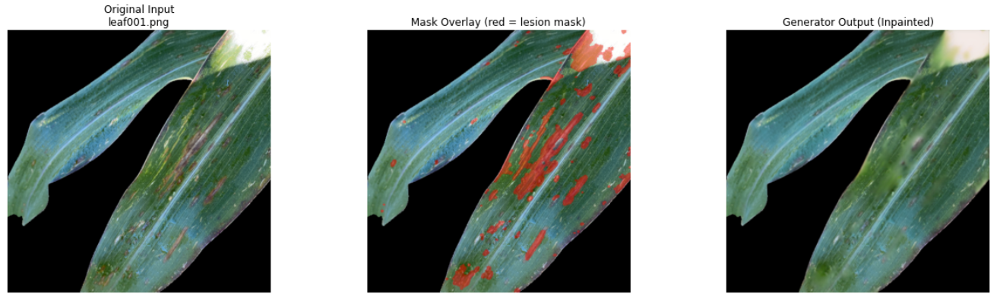
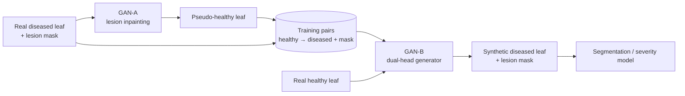
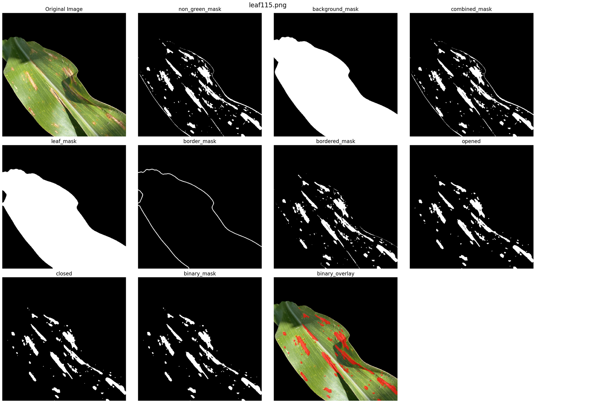

<h1 align="center">MIMIC</h1>

<p align="center">
  <em>Multi-stage inpainting for biologically constrained, pixel-labeled synthetic diseased leaves.</em>
</p>

<p align="center">
  
  
  
  
</p>

<p align="center">
  
</p>

---

**Source:** <a href="https://github.com/unio207/MIMIC">https://github.com/unio207/MIMIC</a>

---

MIMIC is a two-stage GAN pipeline that generates **synthetic diseased corn leaves together with exact lesion masks**, so that segmentation and severity models for **gray leaf spot (GLS)** can be trained when real annotated data is scarce.

The key features are:

* **Anatomy-preserving**: every synthetic image starts from a *real* leaf. MIMIC never hallucinates leaf structure from scratch; it only removes or adds lesions.
* **Paired by construction**: each generated image comes with a pixel-level lesion mask, ready for supervised segmentation.
* **Two decoupled stages**: GAN-A learns lesion *removal*, GAN-B learns lesion *synthesis*. Each is a far more constrained task than "generate a diseased leaf."
* **Biologically grounded masks**: synthetic lesions reuse the real shapes and colors of lesions cut from ~260 infected leaves, aligned to each leaf's orientation.
* **Modular PyTorch code**: the generators, discriminator and loss functions are small, reusable modules in `src/models/`.

## How it works



1. **GAN-A (diseased → healthy).** A U-Net inpainter erases lesions from real diseased leaves, producing pseudo-healthy versions of the same leaves.
2. **GAN-B (healthy → diseased + mask).** A dual-head U-Net trained on those pairs learns to paint realistic lesions onto a healthy leaf *and* to output where it painted them.
3. **Downstream.** At inference, any healthy leaf becomes a new labeled training example. Segmentation and severity models are trained on real + synthetic data and evaluated on held-out real images only.

<details>
<summary><b>Abstract</b></summary>

<br>

Agricultural crop disease management relies heavily on accurate disease detection to mitigate yield loss and guide farmers' decisions. However, deep learning models used for leaf disease detection are constrained by small, imbalanced, and insufficiently annotated datasets. Although image generation models have been used for data augmentation, existing approaches are either unsupervised, failing to preserve biological realism, or rely on high-level class labels, lacking lesion-level paired annotations.

This study proposes MIMIC: a multi-stage inpainting model pipeline for diseased leaf image creation that produces biologically constrained synthetic data to improve detection model accuracy and reliability, supporting earlier intervention and reducing yield loss. Unlike conventional methods that attempt to generate diseased leaves in one step, the proposed method separates the process into two stages. Each stage is made up of a generative adversarial network (GAN) operating sequentially: the first model (GAN-A) removes diseased lesions from real diseased leaves through inpainting to create pseudo-healthy pairs, and the second model (GAN-B) generates synthetic disease lesions from real healthy leaves by training on pseudo-healthy pairs created by the first. By decoupling lesion removal and synthesis, real leaves can be introduced in each training stage, allowing MIMIC to maintain anatomical structure.

The output images are used in conjunction with real leaves to train and compare a severity estimation model against one trained on real data alone. The model trained on MIMIC-augmented data showed improvements in accuracy and generalizability on unseen field images, suggesting that MIMIC can strengthen existing precision disease management technology, even across other diseases.

</details>

## Results so far

**GAN-A Phase 1** (self-supervised inpainting on healthy leaves with synthetic lesion masks), evaluated on 38 held-out test images:

| Metric | Mean |
|---|---|
| L1 error ↓ | 0.0047 |
| SSIM ↑ | 0.958 |
| PSNR ↑ | 41.4 dB |

Per-image scores are in [`results/logs/ganA_test_per_image_metrics.csv`](results/logs/ganA_test_per_image_metrics.csv), and training curves are in [`results/logs/`](results/logs).

<p align="center">
  
  <br>
  <sub>Real lesion mask extraction: HSV thresholding → leaf clipping → morphological cleanup → final mask.</sub>
</p>

## Roadmap

| Component | Status |
|---|---|
| Lesion mask extraction (real + synthetic) | ✅ Done |
| Models and losses (U-Net, PatchGAN, perceptual, SSIM, LSGAN) | ✅ Done |
| GAN-A Phase 1: inpainting on healthy leaves | ✅ Trained, 150 epochs |
| GAN-B baseline: dual-head image + mask generator | 🔄 In progress |
| GAN-A Phase 2: fine-tuning on real diseased leaves | ⏸️ Deferred |
| Real-data-only U-Net segmentation baseline | 🔄 In progress |
| Evaluation: IoU / Dice, severity MAE, FID | ⏳ Planned |
| Experiments: real-only vs synthetic-only vs mixed, dataset size ablations | ⏳ Planned |

## Requirements

* Python 3.10
* PyTorch 2.5 + torchvision (a CUDA GPU is strongly recommended; GAN-A was trained on an A100)
* NumPy, OpenCV, Pillow, scikit-image, SciPy, Matplotlib, tqdm, Jupyter

## Installation

```console
$ git clone https://github.com/unio207/MIMIC.git
$ cd MIMIC
$ conda create -n mimic python=3.10
$ conda activate mimic
$ pip install -r requirements.txt
```

`requirements.txt` installs the CUDA 12.1 build of PyTorch. For a CPU-only machine, change `cu121` to `cpu` in its first line.

[`environment.yml`](environment.yml) has the exact, fully pinned environment used during development (Windows).

## Data

Datasets and model weights are **not stored in this repository** because of their size. Images come from these public sources:

1. Wu, D., Barbedo, J. G. A., Stewart, E. L., Zhang, J., & Nelson, R. J. (2020). *A curated dataset of maize leaf images for disease identification.* Mendeley Data, V1. https://data.mendeley.com/datasets/vy629dngm8/1
2. Hughes, D. P., & Salathé, M. (2015). *An open access repository of images on plant health to enable the development of mobile disease diagnostics.* PlantVillage. https://plantvillage.psu.edu/
3. Wang, G., Sun, Y., & Wang, J. (2017). *CD&S Dataset: Handheld imagery dataset acquired under field conditions for corn disease identification and severity estimation.* https://www.kaggle.com/datasets/gpiosenka/corn-disease-and-severity

The code expects this local layout:

```text
data/
├── healthy/                         ~380 healthy corn leaves
├── diseased/gls/                    ~260 real GLS-infected leaves
├── masks/
│   ├── leaf/                        leaf boundary masks
│   ├── lesion_real/                 real lesion masks (per-image HSV thresholds)
│   ├── lesion_real_expanded/        morphologically expanded real masks
│   ├── lesion_synthetic/            synthetic RGBA lesion overlays
│   ├── lesion_synthetic_binary/     binary PNGs (0/255)
│   └── lesion_synthetic_binary01_npy/   strict 0/1 arrays for training
├── healthy_masked/                  healthy leaves with synthetic lesions composited
└── gan_a/phase_1/{train,test}/{image,mask,binary_mask,outline}/
```

## Usage

Most stages run as notebooks, so they can be used both locally and on cloud GPUs (the `*_linux.ipynb` variants target Lambda Labs):

| Step | Entry point |
|---|---|
| Extract real lesion masks | `src/lesion_mask/gls_mask_creator.ipynb` |
| Generate synthetic lesion masks | `src/data/synthetic_mask_generator.py` |
| Prepare GAN-A data | `src/gan/ganA_data_setup.ipynb` |
| Train GAN-A | `src/gan/ganA_train.ipynb` / `ganA_train_linux.ipynb` |
| Test GAN-A | `src/gan/ganA_model_testing.ipynb` |
| Train GAN-B | `src/gan/ganB_train_linux.ipynb` or the script below |
| Segmentation baseline | `src/image_seg/unet_image_seg_real_data.ipynb` |

Train the GAN-B baseline from the repository root:

```console
$ python src/gan/train_ganB_baseline.py
```

Checkpoints are written to `src/models/checkpoints/`, and logs and sample grids to `results/`.

## Architecture

<details>
<summary><b>GAN-A Phase 1 details</b></summary>

<br>

* **Generator**: U-Net encoder–decoder with skip connections. Input is RGB + binary lesion mask (4 channels), output is RGB (3 channels). Feature widths [64, 128, 256, 512] with a sigmoid output.
* **Discriminator**: 70×70 PatchGAN with spectral and instance normalization.
* **Losses**: L1 (λ = 100), SSIM (λ = 10), VGG16 perceptual on relu1_2/2_2/3_3/4_3 (λ = 10), LSGAN adversarial (λ = 1).
* **Training**: mixed precision (AMP) on an A100, 90/10 train/test split, resumable checkpoints, 150 epochs.

</details>

<details>
<summary><b>Lesion mask pipeline</b></summary>

<br>

* **Real masks**: HSV color thresholding with a per-image threshold table, manually tuned for every GLS image. Followed by a morphological close (5×5, 2 iterations) and dilation (5×5, 1 iteration) clamped to the leaf silhouette. The masks deliberately over-cover so GAN-A inpaints each lesion fully.
* **Synthetic masks**: real lesion shapes and colors are cut from diseased leaves and composited onto healthy leaves, with PCA-based orientation alignment, random scale and translation, and clipping to the leaf boundary. The same morphological refinement is applied.

</details>

## Project structure

```text
src/
├── models/        U-Net inpainter, dual-head GAN-B generator, PatchGAN, losses
├── gan/           GAN-A / GAN-B training and testing (plus explored diffusion, ControlNet, CycleGAN baselines)
├── data/          dataset classes and synthetic lesion mask generator
├── lesion_mask/   HSV-threshold lesion mask extraction
└── image_seg/     U-Net segmentation baseline
experiments/       experiment notebooks
results/           training sample figures and metric logs
media/             figures used in this README
```

## Research question

> Does biologically constrained synthetic lesion generation improve segmentation and severity estimation under limited labeled data, compared to training on real data alone?

## Author

Henry Zou. An ISEF 2026 research project.
